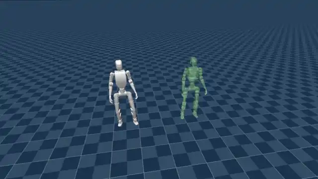

# cyclo_mjlab

Native MuJoCo/mjlab locomotion and motion tracking for the ROBOTIS K1 Rev.1.
Choose the motion-tracking algorithm before installing its runtime:

| Algorithm | Native task IDs | Runtime | Manual |
| --- | --- | --- | --- |
| **BeyondMimic** (existing Mimic/PPO) | `Cyclo-BeyondMimic-K1-Rev1-Dance1`, `Dance2`; historical `Cyclo-Mimic-*` aliases retained | Existing Docker: Python 3.11, mjlab 1.2.0, MuJoCo 3.5.0 | [BeyondMimic](docs/beyondmimic.md) |
| **SuperMimic** (differentiable world model + policy) | `Cyclo-SuperMimic-GenCoord-K1-Rev1`, `Cyclo-SuperMimic-MaxCoord-K1-Rev1` | Isolated Python 3.13, pinned mjlab_research 1.6.0, MuJoCo 3.16.0 | [SuperMimic](docs/supermimic.md) |

Both use `scripts/reinforcement_learning/train.py` and `play.py`. Task IDs infer
the algorithm; optional `--algorithm beyondmimic|supermimic` makes selection
explicit and rejects mismatched tasks. List choices without loading a simulator:

```bash
python scripts/reinforcement_learning/train.py --list-tasks
```

The environments are separate because their mjlab APIs differ. The launcher
checks the active runtime before importing simulator-specific modules; it never
installs packages or changes the current environment automatically.

## Installation

Clone with submodules:

```bash
git clone --recurse-submodules git@github.com:ROBOTIS-GIT/cyclo_mjlab.git
cd cyclo_mjlab
```

For **BeyondMimic and Velocity**, use the existing Docker environment:

```bash
./docker/container.sh start
./docker/container.sh enter
```

For **SuperMimic**, create its separate environment from the host checkout:

```bash
uv sync --project integrations/supermimic --python 3.13 --locked
```

The `integrations/supermimic` directory holds the runtime manifest/lock and
compatibility entry points. The implementation is native source under
`source/tasks/supermimic`; existing PPO tasks stay at `source/tasks/mimic`.
Do not replace the root `pyproject.toml` dependencies with the research runtime.

## Motion tracking quickstart

### BeyondMimic

Inside the existing Docker runtime:

```bash
python scripts/reinforcement_learning/train.py --algorithm beyondmimic \
  Cyclo-BeyondMimic-K1-Rev1-Dance1 --env.scene.num-envs 4096
python scripts/reinforcement_learning/play.py --algorithm beyondmimic \
  Cyclo-BeyondMimic-K1-Rev1-Dance1 \
  --checkpoint-file logs/rsl_rl/k1_mimic/<run>/model_<iteration>.pt --num-envs 1
```

### Mimic

Historical commands remain valid and select the same BeyondMimic/PPO task:

```bash
python scripts/reinforcement_learning/train.py Cyclo-Mimic-K1-Rev1-Dance1 \
  --env.scene.num-envs 4096
```

Dance2 and the original play/ghost/export flags are described in the
[BeyondMimic manual](docs/beyondmimic.md).

### SuperMimic

From the host checkout, pass the **same 50 Hz K1 NPZ** used by BeyondMimic.
The internal adapter validates the reference and supplies the research loader's
root-state layout; no separate conversion step is required:

```bash
WANDB_MODE=offline uv run --project integrations/supermimic python \
  scripts/reinforcement_learning/train.py --algorithm supermimic \
  Cyclo-SuperMimic-GenCoord-K1-Rev1 --motion-file source/assets/motions/K1_rev1/dance1/dance1.npz \
  --num-envs 64 --runner.run-name k1-dance1
uv run --project integrations/supermimic python scripts/reinforcement_learning/play.py \
  --algorithm supermimic Cyclo-SuperMimic-GenCoord-K1-Rev1 \
  --motion-file source/assets/motions/K1_rev1/dance1/dance1.npz --wandb-path ENTITY/PROJECT/RUN --viewer viser
```

Select `MaxCoord` for body-space dynamics. Current playback uses W&B bundles;
offline runs require later explicit sync for this viewer path. The original
`cyclo-supermimic train|play|convert|smoke` commands remain supported.
Check GPU occupancy and choose an appropriate number of environments before
training. First CUDA compilation can take minutes; it is separate from the
number of training iterations.

## Data, outputs and deployment

Shared: K1 MJCF/assets, joint naming and source reference motions. Converted
motion data and learned checkpoints retain each algorithm's format.

| Contract | BeyondMimic/PPO | SuperMimic |
| --- | --- | --- |
| Data | Existing named body-state NPZ | Same Cyclo 50 Hz NPZ; internal verified root-state adapter |
| Output | `logs/rsl_rl/k1_mimic/<run>/model_*.pt` | `logs/Cyclo-SuperMimic-*/<run>/{world_model,actor,critic}.pt` |
| Deployment export | Training: `params/sim2real.yaml`; play: `exported/policy.onnx`, `policy.pt` | Original multi-encoder exporter; conditional ONNX with proprio inputs; existing PPO sim2real contract does not apply |

Checkpoints are not interchangeable. SuperMimic's default privileged `rep_state`
actor is for simulation; sensor-input mode is explicit. See the
[SuperMimic manual](docs/supermimic.md) for current export/verification limits.

## Velocity

Existing Docker/runtime and commands remain unchanged:

```bash
python scripts/reinforcement_learning/train.py Cyclo-Velocity-Flat-K1-Rev1-v0 \
  --env.scene.num-envs 4096
python scripts/reinforcement_learning/play.py Cyclo-Velocity-Flat-K1-Rev1-v0 \
  --checkpoint-file logs/rsl_rl/k1_velocity/<run>/model_<iteration>.pt --num-envs 1
```

## Motion utilities and validation

Run `scripts/tools/motion/csv_to_npz.py --help` and `replay_npz.py --help` in
the existing runtime. `to_supermimic.py` remains an optional research-format export
tool; native SuperMimic train/play adapt supported Cyclo NPZ files automatically.

[Direct reference and regression validation](docs/reference-adapter-validation.md) record the actual
checks, including short CUDA world-model/policy updates for both representations.




## License

This repository is licensed under the
[Apache License 2.0](LICENSE).

### Third-party components

- **MJLab**: Apache License 2.0; see
  [THIRD_PARTY_LICENSES.md](THIRD_PARTY_LICENSES.md)
- **HybridRobotics/whole_body_tracking**: MIT License; see
  [THIRD_PARTY_LICENSES.md](THIRD_PARTY_LICENSES.md)
- **ROBOTIS AI Sapiens K1 Rev.1 assets**: Apache License 2.0; see
  [LICENSE.ai_sapiens](source/assets/robots/robotis_k1/LICENSE.ai_sapiens)
