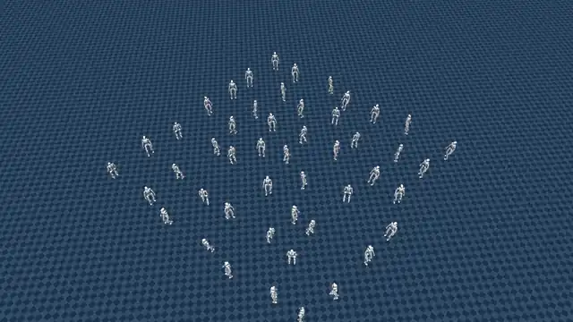
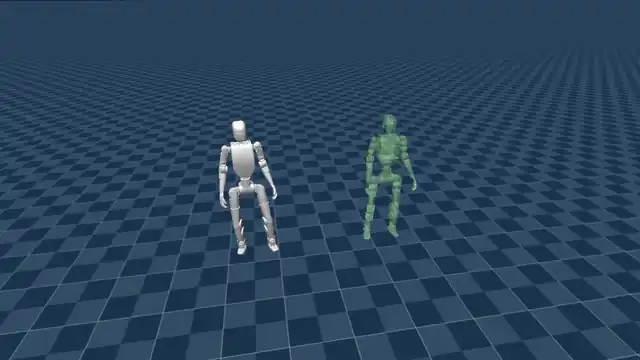

# cyclo_mjlab

[](https://mujoco.readthedocs.io/en/3.5.0/)
[](https://github.com/mujocolab/mjlab)
[](https://docs.python.org/3/whatsnew/3.11.html)
[](https://releases.ubuntu.com/22.04/)
[](https://opensource.org/license/apache-2-0)

## Overview

`cyclo_mjlab` is a research-oriented repository built on
[MJLab](https://github.com/mujocolab/mjlab) and
[MuJoCo](https://mujoco.org/). It provides reinforcement learning environments,
task configurations, and motion-processing tools for developing locomotion and
motion-imitation policies for the ROBOTIS K1 humanoid robot.

The repository currently provides:

- **Velocity**: flat-ground velocity-tracking locomotion
- **Mimic**: Dance1 and Dance2 reference-motion tracking
- Automatic generation of `params/sim2real.yaml` when training starts
- Automatic export of `exported/policy.onnx` and `exported/policy.pt` during play

> [!IMPORTANT]
> This repository currently uses MJLab 1.2.0, MuJoCo 3.5.0, and Python 3.11.

### Locomotion



### Motion imitation



## Installation (Docker)

Docker provides a consistent environment with the required Python packages,
MuJoCo libraries, and GPU configuration pre-installed. Conda and a host Python
environment are not required.

### Prerequisites

- Docker Engine with Docker Compose
- NVIDIA GPU with an appropriate NVIDIA driver
- NVIDIA Container Toolkit
- Git and access to this repository

### Steps

1. Clone the repository with its submodules:

   ```bash
   git clone --recurse-submodules git@github.com:ROBOTIS-GIT/cyclo_mjlab.git
   cd cyclo_mjlab
   ```

   If the repository was cloned without submodules, initialize them separately:

   ```bash
   git submodule update --init --recursive
   ```

2. Build the Docker image when needed and start the container:

   ```bash
   ./docker/container.sh start
   ```

3. Enter the running container:

   ```bash
   ./docker/container.sh enter
   ```

After entering the container, the training and playback commands below can be
run directly from `/workspace/cyclo_mjlab`.

### Docker commands

| Command | Description |
| --- | --- |
| `./docker/container.sh start` | Build the image if needed, initialize submodules, and start the container |
| `./docker/container.sh enter` | Open an interactive shell in the running container |
| `./docker/container.sh stop` | Stop the container |
| `./docker/container.sh logs` | Follow the container logs |
| `./docker/container.sh clean` | Remove the container and image while preserving cache volumes |

The Docker image includes:

- Python 3.11
- MJLab 1.2.0
- MuJoCo and MuJoCo Warp 3.5.0
- Warp 1.12.0
- All dependencies declared in `pyproject.toml`

The project source and `logs/` directory are shared with the host, so training
results remain available after the container is removed.

## Try Examples

### Velocity

#### Train

```bash
python scripts/reinforcement_learning/train.py Cyclo-Velocity-Flat-K1-Rev1-v0 \
  --env.scene.num-envs 4096
```

#### Play

```bash
python scripts/reinforcement_learning/play.py Cyclo-Velocity-Flat-K1-Rev1-v0 \
  --checkpoint-file logs/rsl_rl/k1_velocity/<run>/model_<iteration>.pt \
  --num-envs 1
```

### Mimic

#### Train Dance1

```bash
python scripts/reinforcement_learning/train.py Cyclo-Mimic-K1-Rev1-Dance1 \
  --env.scene.num-envs 4096
```

#### Train Dance2

```bash
python scripts/reinforcement_learning/train.py Cyclo-Mimic-K1-Rev1-Dance2 \
  --env.scene.num-envs 4096
```

#### Train and play Koryo

The Koryo task uses `k1_koryo_converted.npz`: 4,293 frames at 50 Hz
(about 85.84 seconds), converted from the headered 60 Hz source CSV.
It uses the standard K1 Mimic rewards and PPO configuration. Training samples
across the full reference with 30-second episodes; playback starts at frame zero.

```bash
python scripts/reinforcement_learning/train.py Cyclo-Mimic-K1-Rev1-Koryo \
  --env.scene.num-envs 1024 \
  --agent.run-name koryo
```

For a short integration check, append `--agent.max-iterations 2` and use
`--env.scene.num-envs 32`. This verifies PPO updates, not motion mastery.

```bash
python scripts/reinforcement_learning/play.py Cyclo-Mimic-K1-Rev1-Koryo \
  --checkpoint-file logs/rsl_rl/k1_mimic/<run>/model_<iteration>.pt \
  --num-envs 1 \
  --reference-ghost-offset '(1.4, 0, 0)'
```

To regenerate the motion files while preserving the original CSV:

```bash
python scripts/tools/motion/umr_csv_to_npz.py \
  -f source/assets/motions/K1_rev1/koryo/k1_koryo.csv \
  --output_fps 50
```

#### Koryo perturbation curriculum

`Cyclo-Mimic-K1-Rev1-Koryo-Curriculum` retains the original rewards, actor inputs,
25 cm body-height termination, 30-second training episodes and 1–3 second push
interval. Version 2 separates the final noise increase from the push ramp:

| Stage | Reset/observation/physical noise | Push amplitude |
|---|---:|---:|
| 0 | 25% | 0% |
| 1 | 50% | 25% |
| 2 | 75% | 50% |
| 3 | 100% | 50% |
| 4–8 | 100% | 60%, 70%, 80%, 90%, 100% |

Physics randomization is sampled on episode resets. Ten percent of training
environments start at frame zero; the rest mix adaptive starts with 25% uniform
sampling. Their 1,024-attempt, first-30-second success windows are **diagnostics
only**, and cannot promote the stage.

Use the following driver for automatic training and promotion. It runs 1,000
PPO updates, releases the training process/GPU memory, then evaluates the full
85.84-second reference from zero using deterministic actions. Each evaluation
uses three fresh, reproducible seeds with 32 attempts each. A stage advances
only after **90% completion in two consecutive evaluations of distinct trained
checkpoints**. Two passes at stage 8 mark the run `mastered` and stop it early.
The driver also evaluates the original 100% disturbances after every block and
preserves `best_full.pt`; stage 8 reuses the same results for both purposes.
These point-estimate thresholds are operating criteria, not statistical guarantees.

Resume the completed Koryo checkpoint with the revised curriculum:

```bash
python scripts/reinforcement_learning/train_koryo_curriculum.py \
  --checkpoint logs/rsl_rl/k1_mimic/2026-10-08_16-24-44_koryo_curriculum/model_26999.pt \
  --num-envs 2048 --additional-iterations 30000 --eval-every 1000
```

`--additional-iterations` is an upper budget, not a promise of mastery. Add
`--dry-run` to inspect the migration and settings without creating a run or
training. Use `--gpu 0` to select a physical GPU. The source checkpoint is never
overwritten; logs use a new `*_koryo_curriculum_v2` directory.

Legacy stage 3 migrates to **100% other noise / 50% push**, resetting its obsolete
gate counters. Legacy stages 0–2 retain their amplitudes; a checkpoint without
curriculum state starts at stage 0. Version 2 checkpoints preserve stage, gate
streak, PPO optimizer/adaptive learning rate, and adaptive-start failure scores.
Simulator episodes restart at block boundaries. Observations and network shapes
are unchanged, so existing actor/critic weights load directly. Entropy remains
0.005; entropy annealing and observation changes require separate experiments.

The driver prints the run folder and live iteration logs, and saves the same
training output to files. Add `--quiet-training` for file-only training logs.
During evaluation it prints phase/result messages; per-seed details go to files.
Outputs include:

- `resume.pt`: latest checkpoint **after** evaluation, including updated gate state.
- `best_full.pt`: highest 100%-disturbance completion rate evaluated in this run
  (or inherited from a v2 run); aligned body error breaks ties. This is not a
  held-out validation set, so use separate seeds for final reporting.
- `model_<iteration>.pt`: raw training checkpoints, including 500-update saves.
- `evaluated_<iteration>.pt`: archived checkpoint with the subsequent gate decision.
- `evaluations/<iteration>/`: per-seed episodes, tracking errors and summaries.
- `status.json`: distinguishes `training`, `evaluating`, `mastered`,
  `budget_exhausted`, `failed`, and `interrupted`.
- `train_<iteration>.log` and TensorBoard events: training diagnostics.

To continue after exhausting the budget, run the same driver with
`--checkpoint logs/rsl_rl/k1_mimic/<v2-run>/resume.pt` and the desired additional
budget. After an interrupted block, `model_<iteration>.pt` can recover more
recent training updates; it has the previous gate state. `status.json` identifies
the latest completed training checkpoint if evaluation was interrupted.

Direct `train.py ...Koryo-Curriculum` now trains at the loaded **fixed stage**;
use the driver above for automatic promotion. TensorBoard retains the old 30s
diagnostics and adds `full_motion_success_rate`, `full_motion_pass_streak`, and
`mastered`. Full-motion results are also available in evaluation JSON files.

Evaluate a saved policy with fixed starts (default: every integer second from
0 to 85). Use `--condition train` for the original full perturbations, or
`--condition clean` without perturbations. Evaluation always uses deterministic
policy actions and does not update the checkpoint or curriculum.

```bash
python scripts/reinforcement_learning/evaluate_koryo.py \
  --checkpoint logs/rsl_rl/k1_mimic/<run>/model_<iteration>.pt \
  --condition clean \
  --output outputs/koryo_fixed_clean.json

# Attempt the full reference from frame zero.
python scripts/reinforcement_learning/evaluate_koryo.py \
  --checkpoint logs/rsl_rl/k1_mimic/<run>/model_<iteration>.pt \
  --condition train --full-motion --trials 32 --seed 9001 \
  --output outputs/koryo_full_train.json
```

The evaluator records failures, time-limit successes and reference-end successes
separately. Reaching the end of the clip never credits a subsequent teleported
segment as continuous tracking. Repeat with different `--seed` values for a
more reliable comparison.
For a particular curriculum level, use `--condition train --noise-scale 1.0
--push-scale 0.5`. Both scales default to 1.0; clean mode disables all disturbances.

#### Koryo performance contact fine-tuning

`Cyclo-Mimic-K1-Rev1-Koryo-Performance` is an experimental fine-tuning task for
quieter foot contacts. It adds physics-substep force peaks, force changes,
repeated contact transitions, and ankle motion during quiet reference stance
to the objective. A support term discourages hovering during that stance.
Stance is estimated from reference height, linear velocity and angular velocity;
it is a heuristic, not manually annotated contact data. Original motion timing
and policy inputs are unchanged. Thresholds are simulation objectives, not
hardware safety limits.

Run inside the container to warm-start the trained Koryo policy:

```bash
cd /workspace/cyclo_mjlab
python scripts/reinforcement_learning/train.py Cyclo-Mimic-K1-Rev1-Koryo-Performance \
  --checkpoint logs/rsl_rl/k1_mimic/2026-10-09_05-13-57-080692_koryo_curriculum_v2/evaluated_53999.pt \
  --env.scene.num-envs 2048 \
  --agent.max-iterations 5000 \
  --agent.run-name koryo_performance \
  --agent.upload-model False
```

Warm-start restores actor/critic weights, resets the optimizer and iteration,
caps initial exploration standard deviation at 0.1 and uses a fixed learning
rate of 5e-5. Difficulty stays at noise 25%, push 0%; this phase does not advance
the robustness curriculum. A checkpoint saved by this performance task instead
resumes optimizer, iteration and start-sampling state. The original trained
checkpoint and exports are preserved. 5,000 updates are an initial budget,
not a contact-quality acceptance criterion.

Compare a candidate with the original using identical conditions:

```bash
python scripts/reinforcement_learning/evaluate_koryo_contacts.py \
  --checkpoint logs/rsl_rl/k1_mimic/<performance-run>/model_<iteration>.pt \
  --condition clean --seed 42 \
  --output-dir outputs/koryo_candidate_contacts
```

This records one attempt from frame zero, including substep foot forces and
ankle velocities, and stops at failure or reference end before loop resets.
Contact statistics must be compared over matched motion intervals; a policy
that fails early does not pass by accumulating fewer contacts. Inspect the full
clip in the viewer and repeat the full-motion robustness evaluation above with
multiple seeds before replacing a deployed policy. Reduced pushes during
fine-tuning can sacrifice previously learned recovery behavior.

#### Koryo ContactV2 transition refinement

`Cyclo-Mimic-K1-Rev1-Koryo-ContactV2` preserves the Performance V1 task and adds
persistent foot contact state. Contact-on/off thresholds are 20/5 N, with 10 ms
debouncing. Short recontacts are counted across policy steps over a 150 ms
window. Reference flight clears eligibility so a normal first touchdown is free.
Support uses debounced contact occupancy instead of the maximum force in one
step. A 50 ms landing allowance and a 150 ms reset warmup exclude artificial
initialization events. Per-environment resets and reference jumps clear memory.

Reference support is estimated from the lowest colliding foot sphere, accounting
for foot orientation: height hysteresis is 12/25 mm above each foot's minimum
reference sole height, and upward sole speed above 0.2 m/s permits liftoff.
These labels are heuristic. Intended pivots and steps still require visual
checking; contact costs are not measurements of audible noise or hardware limits.

Start from the saved 42,000-iteration Performance V1 policy **inside the container**:

```bash
cd /workspace/cyclo_mjlab
python scripts/reinforcement_learning/train.py Cyclo-Mimic-K1-Rev1-Koryo-ContactV2 \
  --checkpoint logs/rsl_rl/k1_mimic/2026-10-12_03-47-36_koryo_performance_from_scratch/model_42000.pt \
  --env.scene.num-envs 2048 \
  --agent.max-iterations 5000 \
  --agent.run-name koryo_contact_v2 \
  --agent.upload-model False
```

From a host terminal, enter the container with:

```bash
docker exec -it --user cyclo --workdir /workspace/cyclo_mjlab cyclo_mjlab bash
```

V1-to-V2 loading restores networks but resets iteration and optimizer for the new
objective, uses fixed LR 1e-5 and caps exploration std at 0.1. The new transition
objective ramps from 20% to 100% over 24,000 policy steps (1,000 PPO iterations
at 24 steps/update). Existing impact, load-change and quiet-stance motion terms
remain active. V2-to-V2 loading resumes optimizer, iteration, sampler and ramp;
contact memory starts fresh because physics episodes restart. The actor inputs
and reference motion are unchanged. Noise stays at 25%, pushes at 0%; no automatic
disturbance promotion or 85.84-second training cap is introduced by this task.

To resume, replace `--checkpoint` with a checkpoint from the V2 run. To train a
new policy from scratch, omit `--checkpoint` and use the original learning
settings (`--agent.algorithm.learning-rate 0.001 --agent.algorithm.schedule adaptive
--agent.algorithm.entropy-coef 0.005`) with a longer budget. Transition refinement
of an already trained policy is the intended default here.

Use `evaluate_koryo_contacts.py` for matched full-motion contact traces and
`evaluate_koryo.py --condition train --noise-scale 0.25 --push-scale 0
--full-motion` across multiple seeds. Select checkpoints using completion,
tracking and contact quality together; do not treat a lower reward cost alone
as proof that unwanted footsteps disappeared.

#### ContactV2 from scratch with maximum disturbances

`Cyclo-Mimic-K1-Rev1-Koryo-ContactV2-Max` starts with observation noise,
reset noise, domain randomization and pushes at 100% of the configured ranges.
Difficulty remains at stage 8; it does not wait for curriculum promotion.
It adds the ContactV2 contact objectives, retains their 1,000-update transition
reward ramp, and restores the original action-rate weight (-0.1) and PPO
settings (LR 0.001, adaptive schedule, entropy 0.005, initial std 1.0).
Maximum refers to sampling from the full ranges, not applying the largest
possible push every time. Push intervals remain randomized between 1 and 3 s.

Run **inside the container**, without a checkpoint for fresh training:

```bash
cd /workspace/cyclo_mjlab
OMP_NUM_THREADS=1 MKL_NUM_THREADS=1 python -u scripts/reinforcement_learning/train.py \
  Cyclo-Mimic-K1-Rev1-Koryo-ContactV2-Max \
  --env.scene.num-envs 2048 \
  --agent.max-iterations 60000 \
  --agent.run-name koryo_contact_max_from_scratch \
  --agent.upload-model False
```

Checkpoints record the fixed stage, PPO state, contact ramp and start sampler.
Only checkpoints from this task can resume it. Training at full disturbances
from scratch is an experiment; successful learning and contact quality must
still be evaluated. The initial training episode limit is 30 s.

The earlier Performance/ContactV2 training logs were deleted on 2026-10-14 at
the user's request. Their concrete checkpoint paths above are historical
examples and no longer exist; original Koryo and other motions were preserved.

#### ContactV2 with automatic disturbance curriculum

Use this driver to retain the ContactV2 rewards while progressively introducing
disturbances. Stop the old fixed-stage training with Ctrl+C in its terminal, then
run the following **inside the container**. The command selects the highest
saved iteration in the current ContactV2 run; unsaved updates are not recovered.

```bash
cd /workspace/cyclo_mjlab
contact_checkpoint=$(python - <<'PY'
from pathlib import Path
run = Path('logs/rsl_rl/k1_mimic/2026-10-13_00-22-03_koryo_contact_v2')
print(max(run.glob('model_*.pt'), key=lambda p: int(p.stem.split('_')[-1])))
PY
)
python -u scripts/reinforcement_learning/train_koryo_contact_curriculum.py \
  --checkpoint "$contact_checkpoint" \
  --additional-iterations 20000 \
  --eval-every 500 \
  --num-envs 2048
```

Stages 0–8 use `(noise %, push %)` values `(25,0)`, `(50,25)`, `(75,50)`,
`(100,50)`, `(100,60)`, `(100,70)`, `(100,80)`, `(100,90)`, `(100,100)`.
Each 500-update block releases its training environment before evaluation.
At the current stage, three fresh seeds × 32 trials attempt all 85.84 seconds
from frame zero using deterministic actions. At least 90% completion in two
consecutive evaluations promotes one stage; failure resets the pass streak.
Passing the final stage twice ends training. Maximum disturbances are evaluated
separately for tracking progress and selecting `best_full.pt`; this does not
raise the training stage early. The promotion gate measures completion, not
contact quality: the contact penalties remain active, but a promotion does not
certify that footsteps have disappeared. Continue comparing full-motion contact
traces and playback when selecting a performance policy.

The first fixed ContactV2 checkpoint starts at stage 0 and retains its PPO
optimizer, iteration, adaptive start sampler and contact ramp. Subsequent
curriculum checkpoints also retain the stage and evaluation streak. Physics
episodes and contact history restart between blocks; the training cap stays
30 seconds with mixed reference starts. New runs are written to
`logs/rsl_rl/k1_mimic/*_koryo_contact_v2_curriculum/`. Resume the same command
with `--checkpoint <new-run>/resume.pt` to use the latest evaluated stage, or
its latest `model_*.pt` to retain unevaluated training updates after interruption.
The next evaluation will use the stage stored in that checkpoint.

Iteration logs are printed during training and saved to `train_*.log`.
During full-motion evaluation, see `status.json` and `evaluations/` for progress;
no PPO iteration logs are expected during this interval. Plain `train.py` with
the new `...ContactV2-Curriculum` task restores a stage but cannot promote it;
use the driver above for automatic progression.

#### Train and play Taeguek01

The Taeguek01 task uses `taeguek_01/k1_taeguek01_converted.npz`: 1,582
frames at 50 Hz (about 31.62 seconds), converted from the headered 60 Hz CSV.
It uses the standard K1 Mimic rewards and PPO configuration.

For automatic curriculum training, run **inside the container**:

```bash
cd /workspace/cyclo_mjlab
python scripts/reinforcement_learning/train_taeguek01_curriculum.py \
  --num-envs 2048 \
  --additional-iterations 60000 \
  --eval-every 1000
```

This starts a new policy at stage 0 using
`Cyclo-Mimic-K1-Rev1-Taeguek01-Curriculum`. It shares the Koryo v2 schedule above:
other noise increases from 25% to 100%, then pushes increase to 100% in steps.
Training episodes remain capped at 30 seconds. Every 1,000 updates, the driver
evaluates the **entire 31.62-second motion from frame zero**, both at the current
stage and at maximum disturbances, using three seeds with 32 attempts each.
At least 90% completion in two consecutive evaluations advances the stage;
passing twice at the final stage stops training. The 60,000-update budget is an
upper bound, not a guarantee of mastery.

Iteration logs appear in the terminal and in the new
`logs/rsl_rl/k1_mimic/*_taeguek01_curriculum_v2/` folder. The checkpoint names,
evaluation reports and `status.json` follow the Koryo driver described above.
To resume, add `--checkpoint logs/rsl_rl/k1_mimic/<taeguek01-run>/resume.pt`
to the same command. Motion identity and NPZ content hash are checked on resume;
Koryo checkpoints cannot carry their curriculum state into this task.

Evaluate a saved policy independently at maximum disturbances:

```bash
python scripts/reinforcement_learning/evaluate_taeguek01.py \
  --checkpoint logs/rsl_rl/k1_mimic/<taeguek01-run>/resume.pt \
  --condition train --full-motion --trials 32 --seed 9001 \
  --output outputs/taeguek01_full_train.json
```

Repeat with other seeds for final reporting. `best_full.pt` is selected from
training-time evaluations and should also be checked on independent seeds.

The original baseline training and playback remain available:

```bash
python scripts/reinforcement_learning/train.py Cyclo-Mimic-K1-Rev1-Taeguek01 \
  --env.scene.num-envs 1024 \
  --agent.run-name taeguek01

python scripts/reinforcement_learning/play.py Cyclo-Mimic-K1-Rev1-Taeguek01 \
  --checkpoint-file logs/rsl_rl/k1_mimic/<run>/model_<iteration>.pt \
  --num-envs 1 \
  --reference-ghost-offset '(1.4, 0, 0)'
```

To regenerate the motion files while preserving the original CSV:

```bash
python scripts/tools/motion/umr_csv_to_npz.py \
  -f source/assets/motions/K1_rev1/taeguek_01/k1_taeguek01.csv \
  --output_fps 50
```

#### Train and play Taeguek02

Taeguek02 uses `taeguek_02/k1_taeguek02_converted.npz`: 1,647 frames at
50 Hz (32.92 seconds), converted from the 60 Hz headered CSV. Inside the container:

```bash
cd /workspace/cyclo_mjlab
python scripts/reinforcement_learning/train_taeguek02_curriculum.py \
  --num-envs 2048 \
  --additional-iterations 60000 \
  --eval-every 1000
```

This starts from scratch with the same Koryo/Taeguek01 curriculum. Every 1,000
updates, the entire 32.92-second motion is evaluated from frame zero, using
three seeds with 32 attempts each per condition. Two consecutive evaluations
at or above 90% completion advance the stage; passing twice at the final
100%-disturbance stage stops early. Training episodes remain capped at 30 seconds.
The 60,000-update limit is an upper budget, not a guarantee of mastery.
Iteration logs appear in both the terminal and the run folder.

To resume, add `--checkpoint logs/rsl_rl/k1_mimic/<taeguek02-run>/resume.pt`.
Checkpoint identity prevents importing another motion's curriculum state.

```bash
python scripts/reinforcement_learning/play.py Cyclo-Mimic-K1-Rev1-Taeguek02 \
  --checkpoint-file logs/rsl_rl/k1_mimic/<taeguek02-run>/resume.pt \
  --num-envs 1 --viewer viser --reference-ghost-offset '(0, 1.2, 0)'

python scripts/reinforcement_learning/evaluate_taeguek02.py \
  --checkpoint logs/rsl_rl/k1_mimic/<taeguek02-run>/resume.pt \
  --condition train --full-motion --trials 32 --seed 9001 \
  --output outputs/taeguek02_full_train.json
```

To regenerate the NPZ and numeric CSV while preserving the original:

```bash
python scripts/tools/motion/umr_csv_to_npz.py \
  -f source/assets/motions/K1_rev1/taeguek_02/k1_taeguek02.csv \
  --output_fps 50
```

#### Play Dance1

```bash
python scripts/reinforcement_learning/play.py Cyclo-Mimic-K1-Rev1-Dance1 \
  --checkpoint-file logs/rsl_rl/k1_mimic/<run>/model_<iteration>.pt \
  --num-envs 1
```

To display the reference trajectory next to the trained policy during playback:

```bash
python scripts/reinforcement_learning/play.py Cyclo-Mimic-K1-Rev1-Dance1 \
  --checkpoint-file logs/rsl_rl/k1_mimic/<run>/model_<iteration>.pt \
  --num-envs 1 \
  --reference-ghost-offset '(1.4, 0, 0)'
```

#### Play Dance2

```bash
python scripts/reinforcement_learning/play.py Cyclo-Mimic-K1-Rev1-Dance2 \
  --checkpoint-file logs/rsl_rl/k1_mimic/<run>/model_<iteration>.pt \
  --num-envs 1
```

Replace `<run>` and `<iteration>` with the timestamped run directory and model
iteration to use.

#### Train UMR Get-Up

The UMR task tracks the standing → prone → standing reference on a plane.
It uses the converted 50 Hz motion and the same K1 model and PPO configuration
as the dance tasks. Only this task disables the dance-specific undesired-contact
penalty because knee, arm, and torso contacts are intentional in this motion.
Reference-relative termination checks remain enabled.

```bash
python scripts/reinforcement_learning/train.py Cyclo-Mimic-K1-Rev1-UMR-Getup \
  --env.scene.num-envs 1024 \
  --agent.run-name umr_getup
```

For a short integration check, use `--env.scene.num-envs 32
--agent.max-iterations 2`. This checks initialization and PPO updates, not
successful physical tracking of the complete motion.

```bash
python scripts/reinforcement_learning/play.py Cyclo-Mimic-K1-Rev1-UMR-Getup \
  --checkpoint-file logs/rsl_rl/k1_mimic/<run>/model_<iteration>.pt \
  --num-envs 1
```

## Motion Utilities

The motion tools convert K1 CSV motion data into the MuJoCo-ordered NPZ format
and validate or replay the converted trajectory:

```bash
python scripts/tools/motion/csv_to_npz.py --help
python scripts/tools/motion/replay_npz.py --help
```

The headered UMR CSV can be converted directly, without removing its time column.
Input FPS is inferred from `time_s`; output defaults to 50 Hz. Root quaternion
components and joint columns are read by name. Outputs use the `_converted`
suffix so the original UMR files are preserved.

```bash
python scripts/tools/motion/umr_csv_to_npz.py \
  -f source/assets/motions/K1_rev1/umr_getup/k1_getup_12s_30hz.csv \
  --output_fps 50
```

## License

This repository is licensed under the
[Apache License 2.0](LICENSE).

### Third-party components

- **MJLab**: Apache License 2.0; see
  [THIRD_PARTY_LICENSES.md](THIRD_PARTY_LICENSES.md)
- **HybridRobotics/whole_body_tracking**: MIT License; see
  [THIRD_PARTY_LICENSES.md](THIRD_PARTY_LICENSES.md)
- **ROBOTIS AI Sapiens K1 Rev.1 assets**: Apache License 2.0; see
  [LICENSE.ai_sapiens](source/assets/robots/robotis_k1/LICENSE.ai_sapiens)
